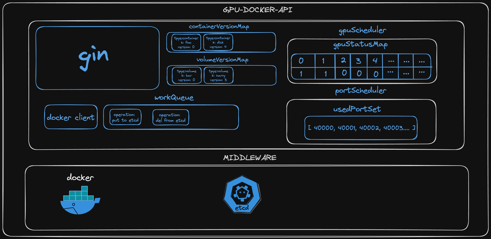

# GPU-Docker-API


[](https://goreportcard.com/badge/github.com/mayooot/gpu-docker-api)

[English](..%2FREADME.md)

# 介绍

> **项目状态**：本项目最初是一个**概念验证（PoC）**，用来验证“不依赖 Kubernetes，在调整 GPU 数量或卷大小时，
> 通过新建容器并拷贝旧容器的 Overlay2 merged 层，保留用户安装的软件和数据”是否可行。容器版本、GPU / 端口调度和基于
> etcd 的回滚都是围绕这一核心思路构建的。目前处于**维护模式**，欢迎修复类贡献，暂无大功能规划。
> 已知限制（单机 PoC 的设计取舍）：仅支持单机；每次更新会全量拷贝 merged 层（包含镜像层），大镜像较慢且占用额外磁盘；
> 已停止容器的 merged 层不会挂载，重启已停止的容器可能无法带上文件；状态会在每次变更时写入 etcd，但启动时不会与 `docker ps` 对账。

使用 Docker 客户端调用 NVIDIA Docker 实现 GPU 容器的业务功能。例如，提升 GPU 容器配置、启动无卡容器、扩缩容卷大小。

类似于 [AutoDL](https://www.autodl.com/docs/env/) 中关于容器实例的操作。

- [GPU-Docker-API](#gpu-docker-api)
- [介绍](#介绍)
- [实现的功能](#实现的功能)
    - [副本集](#副本集)
    - [卷](#卷)
    - [资源](#资源)
- [快速开始](#快速开始)
    - [如何使用](#如何使用)
    - [环境准备](#环境准备)
    - [使用源码构建](#使用源码构建)
    - [下载发布版本](#下载发布版本)
    - [运行](#运行)
    - [如何重置](#如何重置)
- [架构](#架构)
    - [组件介绍](#组件介绍)
    - [架构图](#架构图)
    - [文档](#文档)
- [贡献代码](#贡献代码)
- [环境](#环境)

首先我需要描述 GPU 容器在启动时的目录结构应该是什么样的。如下：

| 名称   | 路径            | 性能     | 说明                                                                                            |
|------|---------------|--------|-----------------------------------------------------------------------------------------------|
| 系统盘  | /             | 本地盘，快  | 容器停止后数据不会丢失。一般系统依赖和 Python 安装包都会在系统盘下，保存镜像时会保留这些数据。容器升降 GPU、Volume 配置后，数据会拷贝到新容器。             |
| 数据盘  | /root/foo-tmp | 本地盘，快  | 使用 Docker Volume 挂载，容器停止后数据不会丢失，保存镜像时不会保留这些数据。适合存放读写 IO 要求高的数据。容器升降 GPU、Volume 配置后，数据会拷贝到新容器。 |
| 文件存储 | /root/foo-fs  | 网络盘，一般 | 可以实现多个容器文件同步共享，例如 NFS。                                                                        |

接下来我们讨论更新操作（提升 GPU 容器配置、放大和缩小卷大小，所有这些都是更新操作，为了便于理解，我们将使用“更新”一词而不是这些具体的操作）。

当我们更新一个容器时，会创建一个新的容器。

例如，如果旧容器 foo-0 使用了 3 个图形卡，我们想让它使用 5 个图形卡，调用接口创建新容器，foo-1 将被创建以替换 foo-0（foo-0
不会被删除），类似于在 K8s 中更新 Pod 会进行滚动替换。

值得注意的是，新容器与旧容器看起来没什么不同，除了我们指定要更新的部分，甚至你安装的软件，也会原样出现在新容器中。

更不用说，数据盘、文件存储、环境变量和端口映射了。

看起来相当酷 😎。

更新卷时也是如此。

# 实现的功能

## 副本集

- [x] 通过副本集运行一个容器

- [x]  通过副本集提交容器为镜像
- [x]  通过副本集在容器中执行命令
- [x]  通过副本集对容器进行补丁
- [x]  通过副本集回滚容器
- [x]  通过副本集停止容器
- [x]  通过副本集重启容器
- [x]  通过副本集暂停一个副本集
- [x]  通过副本集继续一个副本集
- [x]  获取副本集的版本信息
- [x]  获取所有副本集的版本信息
- [x]  通过副本集删除一个容器

## 卷

- [x] 创建指定容量大小的卷
- [x]  更新卷
- [x] 获取卷版本信息
- [x] 获取卷所有版本信息
- [x] 删除卷

## 资源

- [x] 查看 GPU 使用情况
- [x] 查看端口使用情况

# 快速开始

[👉点此查看，我的测试环境信息](#Environment)

## 如何使用

- 将 [gpu-docker-api-en.openapi.json](https://chat.openai.com/c/api%2Fgpu-docker-api-en.openapi.json) 导入到 [ApiFox](https://apifox.com/)。
- 查看 [gpu-docker-api-en.md](https://chat.openai.com/c/api%2Fgpu-docker-api-en.md)。
- 查看这个[在线API](https://apifox.com/apidoc/shared-cca36339-a3f1-4f6b-b8fe-4274ef3529ec)，但是它可能随时过期。

从[ApiFox](https://apifox.com)导入 [gpu-docker-api.openapi.json](api%2Fgpu-docker-api.openapi.json) 以调用 api。

## 环境准备

1. Linux 服务器已安装了 NVIDIA GPU 驱动程序、NVIDIA Docker 和 ETCD V3。
2. [可选] 如果您想指定 Docker 卷的大小，您需要将 Docker 的 `Storage Driver` 设置为 `Overlay2`，并将 `Docker Root Dir` 设置为 `XFS` 文件系统。

## 使用源码构建

~~~
git clone https://github.com/mayooot/gpu-docker-api.git
cd gpu-docker-api
make build
~~~

## 下载发布版本

[release](https://github.com/mayooot/gpu-docker-api/releases)

## 运行

您可以使用 `-h` 参数获取帮助信息和默认配置。

```bash
$ ./gpu-docker-api-linux-amd64 -h
GPU-DOCKER-API
 BRANCH: feat/union-patch-and-version-control
 Version: v0.0.2-12-gc29670a
 COMMIT: c29670a1dfa8bc5470e282ce9b214398baab3a15
 GoVersion: go1.21.4
 BuildTime: 2024-01-23T13:55:51+0800

Usage of ./gpu-docker-api-linux-amd64:
  -a, --addr string        Address of gpu-docker-routers server,format: ip:port (default "0.0.0.0:2378")
  -e, --etcd string        Address of etcd server,format: ip:port (default "0.0.0.0:2379")
  -l, --logLevel string    Log level, optional: release (default "debug")
  -p, --portRange string   Port range of docker container,format: startPort-endPort (default "40000-65535")
pflag: help requested
```

使用它。

~~~bash
./gpu-docker-api-${your_os}-amd64
~~~

## 如何重置

如您所知，我们将一些信息保存在 etcd 和本地，因此当您想要删除它们时，可以使用这个 [reset.sh](https://chat.openai.com/c/scripts%2Freset.sh) 脚本。

或者，如果您从发布版本下载了可执行文件，您可以使用以下命令获取它并将其放置在可执行文件所在的位置。

```bash
wget https://github.com/mayooot/gpu-docker-api/blob/main/scripts/reset.sh
```


# 架构

设计上受到了许多 Kubernetes 的启发和借鉴。

比如 K8s 将会资源（Pod、Deployment 等）的全量信息添加到 ETCD 中，然后使用 ETCD 的版本号进行回滚。

以及 Client-go 中的 workQueue 异步处理。

## 组件介绍


- gin：处理 HTTP 请求和接口路由。

- docker-client：与 Docker 服务器交互。

- workQueue：异步处理任务，例如：

  - 当创建容器/卷时，将创建的信息添加到 ETCD 中。

  - 删除容器/卷后，从 ETCD 中删除有关资源的全部信息。

- container/volume VersionMap：

  - 创建容器时生成版本号，默认为 1，当更新容器时，版本号会增加 1。

  - 创建卷时生成版本号，默认为 1，当更新卷时，版本号会增加 1。

- gpuScheduler：分配 GPU 资源并保存已使用的 GPU 的调度程序。
  - gpuStatusMap： 维护服务器的 GPU 资源，在程序首次启动时，调用 `nvidia-smi` 获取所有 GPU 资源，并初始化 gpuStatusMap。 键是 GPU 的 UUID，值是使用情况，0 表示已用，1 表示未使用。

- portScheduler：分配端口资源并保存已使用的端口的调度程序。
  - usedPortSet： 维护服务器的端口资源。已使用的端口将添加到此集合中。

- docker：实际创建容器、卷等资源的组件。使用 [NVIDIA Container Toolkit](https://docs.nvidia.com/datacenter/cloud-native/container-toolkit/latest/install-guide.html) 以便调度 GPU。

- etcd：保存容器/卷创建信息。当前正在使用以下键：

  - /gpu-docker-api/apis/v1/containers

  - /gpu-docker-api/apis/v1/volumes

  - /gpu-docker-api/apis/v1/gpus/gpuStatusMapKey

  - /gpu-docker-api/apis/v1/ports/usedPortSetKey

  - /gpu-docker-api/apis/v1/merges/containerMergeMapKey

  - /gpu-docker-api/apis/v1/versions/containerVersionMapKey

  - /gpu-docker-api/apis/v1/versions/volumeVersionMapKey

## 架构图



## 文档

* 容器升降 GPU 资源的实现: [container-gpu-scale.md](container%2Fcontainer-gpu-scale.md)
* Volume 扩缩容的实现: [volume-size-scale.md](volume%2Fvolume-size-scale.md)

# 贡献代码

欢迎贡献代码或 issue!

## 环境

## 开发环境

~~~ 
$ sw_vers
ProductName:		macOS
ProductVersion:		14.0
BuildVersion:		23A344

$ sysctl -n machdep.cpu.brand_string
Apple M1

$ go version
go version go1.21.5 darwin/arm64
~~~

## 测试环境

~~~
$ cat /etc/issue
Ubuntu 20.04.4 LTS
~~~

~~~
$ docker info
Client: Docker Engine - Community
 Version:    24.0.5
 Context:    default
 Debug Mode: false
 Plugins:
  buildx: Docker Buildx (Docker Inc.)
    Version:  v0.11.2
    Path:     /usr/libexec/docker/cli-plugins/docker-buildx
  compose: Docker Compose (Docker Inc.)
    Version:  v2.20.2
    Path:     /usr/libexec/docker/cli-plugins/docker-compose

Server:
 Containers: 27
  Running: 20
  Paused: 0
  Stopped: 7
 Images: 38
 Server Version: 24.0.5
 Storage Driver: overlay2
  Backing Filesystem: xfs
  Supports d_type: true
  Using metacopy: false
  Native Overlay Diff: true
  userxattr: false
 Logging Driver: json-file
 Cgroup Driver: cgroupfs
 Cgroup Version: 1
 Plugins:
  Volume: local
  Network: bridge host ipvlan macvlan null overlay
  Log: awslogs fluentd gcplogs gelf journald json-file local logentries splunk syslog
 Swarm: inactive
 Runtimes: io.containerd.runc.v2 runc
 Default Runtime: runc
 Init Binary: docker-init
 containerd version: 8165feabfdfe38c65b599c4993d227328c231fca
 runc version: v1.1.8-0-g82f18fe
 init version: de40ad0
 Security Options:
  apparmor
  seccomp
   Profile: builtin
 Kernel Version: 5.4.0-100-generic
 Operating System: Ubuntu 20.04.4 LTS
 OSType: linux
 Architecture: x86_64
 CPUs: 112
 Total Memory: 1.968TiB
 Name: langfang21
 ID: 58c56043-2c92-4d9f-8cb7-14ffa0541531
 Docker Root Dir: /localData/docker
 Debug Mode: false
 Username: *****
 Experimental: false
 Insecure Registries:
  *****
  127.0.0.0/8
 Registry Mirrors:
  *****
  *****
 Live Restore Enabled: false

WARNING: No swap limit support

~~~

~~~
$ nvidia-smi 
Sat Dec  9 09:04:06 2023       
+-----------------------------------------------------------------------------+
| NVIDIA-SMI 525.85.12    Driver Version: 525.85.12    CUDA Version: 12.0     |
|-------------------------------+----------------------+----------------------+
| GPU  Name        Persistence-M| Bus-Id        Disp.A | Volatile Uncorr. ECC |
| Fan  Temp  Perf  Pwr:Usage/Cap|         Memory-Usage | GPU-Util  Compute M. |
|                               |                      |               MIG M. |
|===============================+======================+======================|
|   0  NVIDIA A100 80G...  On   | 00000000:35:00.0 Off |                    0 |
| N/A   46C    P0    73W / 300W |  57828MiB / 81920MiB |      0%      Default |
|                               |                      |             Disabled |
+-------------------------------+----------------------+----------------------+
|   1  NVIDIA A100 80G...  On   | 00000000:36:00.0 Off |                    0 |
| N/A   44C    P0    66W / 300W |  51826MiB / 81920MiB |      0%      Default |
|                               |                      |             Disabled |
+-------------------------------+----------------------+----------------------+
|   2  NVIDIA A100 80G...  On   | 00000000:39:00.0 Off |                    0 |
| N/A   45C    P0    72W / 300W |  12916MiB / 81920MiB |      0%      Default |
|                               |                      |             Disabled |
+-------------------------------+----------------------+----------------------+
|   3  NVIDIA A100 80G...  On   | 00000000:3D:00.0 Off |                    0 |
| N/A   42C    P0    62W / 300W |  12472MiB / 81920MiB |      0%      Default |
|                               |                      |             Disabled |
+-------------------------------+----------------------+----------------------+
|   4  NVIDIA A100 80G...  On   | 00000000:89:00.0 Off |                    0 |
| N/A   48C    P0    72W / 300W |  26140MiB / 81920MiB |      0%      Default |
|                               |                      |             Disabled |
+-------------------------------+----------------------+----------------------+
|   5  NVIDIA A100 80G...  On   | 00000000:8A:00.0 Off |                    0 |
| N/A   40C    P0    45W / 300W |      2MiB / 81920MiB |      0%      Default |
|                               |                      |             Disabled |
+-------------------------------+----------------------+----------------------+
|   6  NVIDIA A100 80G...  On   | 00000000:8D:00.0 Off |                    0 |
| N/A   39C    P0    46W / 300W |      2MiB / 81920MiB |      0%      Default |
|                               |                      |             Disabled |
+-------------------------------+----------------------+----------------------+
|   7  NVIDIA A100 80G...  On   | 00000000:91:00.0 Off |                    0 |
| N/A   39C    P0    46W / 300W |      2MiB / 81920MiB |      0%      Default |
|                               |                      |             Disabled |
+-----------------------------------------------------------------------------+
                                                                               
+-----------------------------------------------------------------------------+
| Processes:                                                                  |
|  GPU   GI   CI        PID   Type   Process name                  GPU Memory |
|        ID   ID                                                   Usage      |
|=============================================================================|
|    0   N/A  N/A    ******      C   ******                            *****MiB |
|    0   N/A  N/A    ******      C   ******                            *****MiB |
|    0   N/A  N/A    ******      C   ******                            *****MiB |
|    0   N/A  N/A    ******      C   ******                            *****MiB |
|    0   N/A  N/A    ******      C   ******                            *****MiB |
|    0   N/A  N/A    ******      C   ******                            *****MiB |
|    0   N/A  N/A    ******      C   ******                            *****MiB |
|    1   N/A  N/A    ******      C   ******                            *****MiB |
|    2   N/A  N/A    ******      C   ******                            *****MiB |
|    3   N/A  N/A    ******      C   ******                            *****MiB |
|    4   N/A  N/A    ******      C   ******                            *****MiB |
|    4   N/A  N/A    ******      C   ******                            *****MiB |
+-----------------------------------------------------------------------------+
~~~

